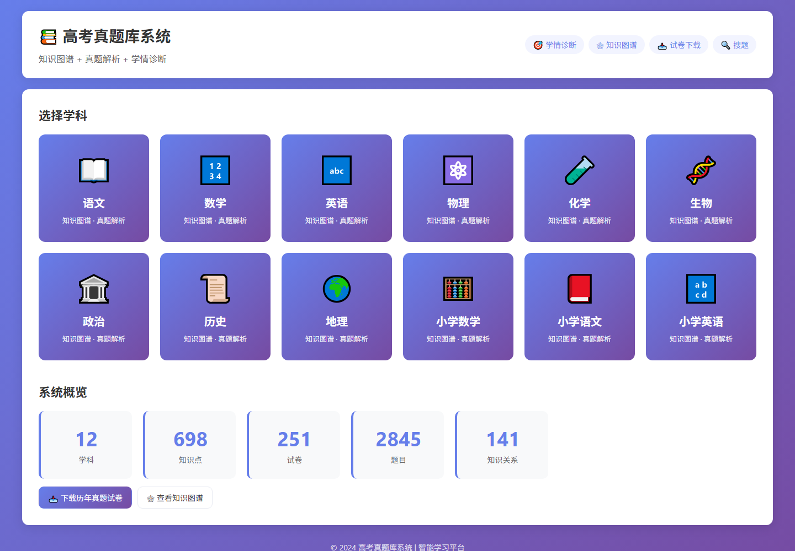
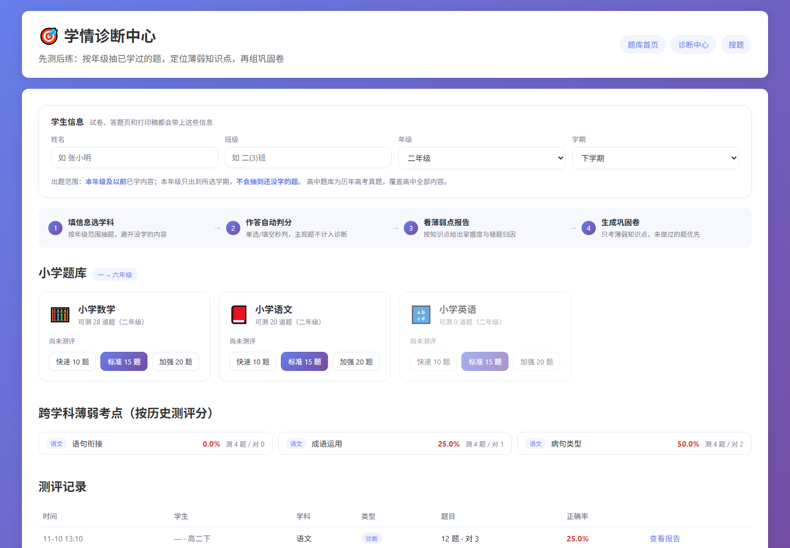
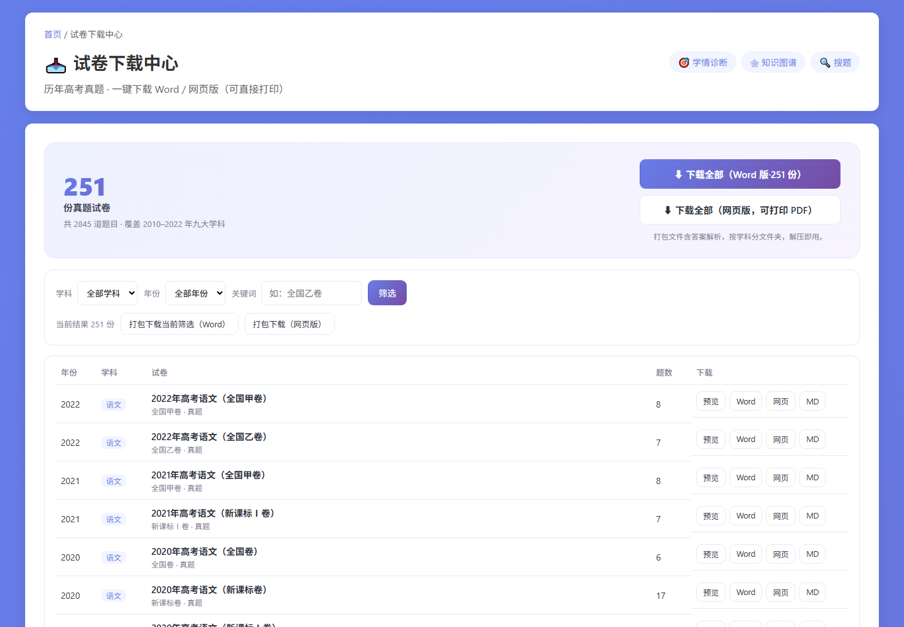
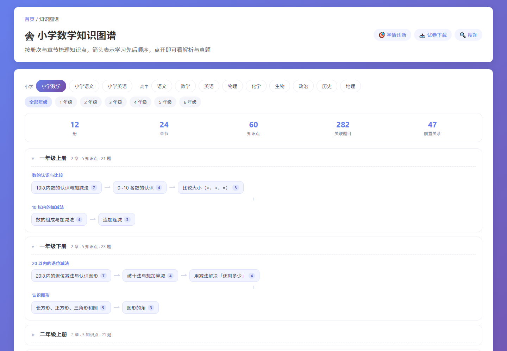

# 高考真题智能题库 · SmartGaokaoPastPapers

> 把 2010–2022 年九科高考真题、538 个高中的知识点解析、192 道小学题，装进一个能「诊断 → 出卷 → 巩固」的学习系统。

[](https://github.com/hbxt008/SmartGaokaoPastPapers/actions/workflows/ci.yml)
[](https://www.python.org/)
[](LICENSE)
[](https://fastapi.tiangolo.com/)

**问题反馈**：[Issues](https://github.com/hbxt008/SmartGaokaoPastPapers/issues)

---

## 这是什么

一个纯 Python + SQLite 的单机 Web 应用，不需要外部数据库、不需要账号体系，`git clone` 后两条命令即可跑起来。核心是四件事：

| 模块 | 做什么 |
|---|---|
| **知识图谱** | 高中 538 个知识点按「学科 → 册/模块 → 章节 → 知识点」四级组织，带 141 条前置关系；小学 32 册 / 64 章 / 160 个课时知识点 |
| **真题库** | 251 份试卷、2653 道高考真题（2010–2022 九科），材料题自动拆成小题，公式用 MathJax 渲染 |
| **诊断测评** | 按学生姓名 / 年级 / 班级 / 学期出题，**只抽已学范围内的题**；交卷后按知识点算出 `薄弱 < 60 < 掌握不牢 < 80 < 良好`，自动生成**巩固卷**专攻薄弱点 |
| **试卷下载** | 历年真题开放下载：单卷 Word / HTML / Markdown，或整科打包 zip；打印排版适配 A4、公式与答题横线 |

## 界面一览

| 首页 | 学情诊断 |
|---|---|
|  |  |
| **试卷下载** | **知识图谱** |
|  |  |

## 数据概览

```
学科            12（高中 9 + 小学 3）        试卷          251 份（2010–2022）
高考真题        2653 道                      小学题        192 道（1–6 年级，上下册）
知识点          698 个（高中 538 + 小学 160） 解析覆盖率    100%
题目-知识点关联  2366 条                      前置关系      141 条
可直接自动判分   2426 道（含材料题拆出的小题）
```

各科高中题量：数学 733 / 历史 415 / 政治 380 / 英语 334 / 语文 266 / 生物 266 / 化学 133 / 物理 64 / 地理 62。

## 快速开始

需要 Python **3.10+**。

```bash
git clone https://github.com/hbxt008/SmartGaokaoPastPapers.git
cd SmartGaokaoPastPapers

pip install -r requirements.txt
python scripts/bootstrap.py          # 用仓库里的 data/ 重建数据库，约 5 秒
python -m uvicorn src.web.app:app --port 8000
```

打开 <http://127.0.0.1:8000> 即可。`bootstrap.py` 跑完会打印数据校验表，全部打 ✓ 说明库是好的。

> 重建一份干净的库：`python scripts/bootstrap.py --force`；只检查数据：`python scripts/bootstrap.py --check`。

## 目录结构

```
database/       schema.sql + init_db.py（建表与学科基础数据）
data/
  gaokao_bench/ GAOKAO-Bench 原始 JSON（30 个文件，唯一权威题源）
  kp_content/   538 个知识点解析正文（Markdown，按学科分文件）
  primary/      小学三科题库 + 图谱编排表 graph_map.json
scripts/        bootstrap / 导入 / 关联 / 小学图谱 / 模拟测评
src/
  knowledge_graph/  九科知识图谱构建（各科一个 builder）
  paper_parser/     docx / pdf / OMML→LaTeX 解析
  question_bank/    题目抽取、去重、知识点匹配
  web/
    app.py            路由与 API
    quiz_engine.py    诊断测评引擎（范围过滤、抽题、判分、分析、组巩固卷）
    paper_export.py   试卷导出 docx / html / md
    templates/        11 个 Jinja2 页面
    static/           样式与脚本
deploy/         腾讯云 + Nginx + systemd 部署脚本（可选）
```

## 关键实现说明

- **年级范围过滤**（`quiz_engine.in_scope`）：小学按「年级 + 学期」累计，二年级下册只会抽到二年级上册及之前的题；高中按必修 / 选择性必修顺序放行，避免抽到还没学的内容。
- **抽题权重**（`quiz_engine.sample`）：本年级题目约 65% 权重，单知识点最多占题量的 60%，防止一张卷子全考同一个知识点。
- **知识点匹配**（`scripts/relink_kp.py`）：不用朴素的字符串包含，而是把知识点名拆成关键词、按 `len(kw)² × 词频` 打分，超过阈值才算命中，第二名达到主考点 55% 才记为「次要考点」。旧的朴素匹配会让「不等式」关联到 49 道无关题，改完后 2653 道题里有 1210 道拿到合理关联。
- **材料题组拆分**（`split_question_group`）：一道材料题下挂 3–5 个小题时拆成独立可判分的单元，否则整组题都进不了测评池（地理科目靠这一步从 0 道可用题变成 34 道）。

## 部署

### Docker（推荐）

```bash
docker compose up -d --build      # 构建时顺手把数据库建好
# 访问 http://127.0.0.1:8000
```

### Render / Railway / Fly.io

仓库根目录带 `render.yaml`，在 Render 里选 **New → Blueprint** 指向本仓库即可；其他平台直接用 `Dockerfile`，健康检查走 `/health`。

### 自有服务器（Nginx + systemd）

见 `deploy/deploy_remote.sh`、`deploy/smart-gaokao-pastpapers.service`、`deploy/nginx.pastpapers-location.conf`。支持子路径部署：设置 `APP_BASE_PATH=/pastpapers` 即可挂在 `https://example.com/pastpapers/` 下。

### 环境变量

| 变量 | 默认 | 说明 |
|---|---|---|
| `BIND_HOST` / `BIND_PORT` | `0.0.0.0` / `8000` | 监听地址 |
| `GAOKAO_DB` | `database/gaokao.db` | 数据库路径 |
| `APP_BASE_PATH` | 空 | 子路径前缀，如 `/pastpapers` |

## 数据来源与许可

- 高考真题：**[GAOKAO-Bench](https://github.com/OpenLMLab/GAOKAO-Bench)**（OpenLMLab，2010–2022 九科），本项目在其基础上做了解析清洗、材料题拆分与知识点关联。
- 小学题库、538 个知识点解析正文、知识图谱与前置关系：本项目原创整理，随代码以 MIT 协议开放。
- 试题原文版权归原命题单位（教育部教育考试院及各省市考试院）所有，本项目仅用于学习与研究；如权利人认为不妥，请开 Issue，我们会及时下架对应内容。

## 参与贡献

这个项目最缺的不是代码，是**数据校对**。以下任务都适合第一次贡献，具体操作见 [CONTRIBUTING.md](CONTRIBUTING.md)：

- 🐛 **报错题**：答案错、选项缺失、公式渲染错乱 —— 附试卷名 + 题号开 Issue 即可，不需要改代码
- 📝 **补解析**：`data/kp_content/*.json` 里每个知识点是一段 Markdown，按「定义 / 核心结论 / 常考题型 / 易错点」补全
- 🧩 **扩题库**：把 2023 年后的新高考卷整理成 JSON（结构见 CONTRIBUTING）
- 🎯 **校准关联**：`scripts/relink_kp.py` 的阈值与停用词表欢迎调参，请附前后对比数据
- 💻 **前端 / 功能**：错题本、知识点推荐路径、移动端适配都在 Roadmap 里

提交前请跑一遍 `python scripts/bootstrap.py --check`；CI 会做一次完整的从零重建，确保你的改动可复现。

## Roadmap

- [ ] 错题本与跨次测评的长期掌握度曲线
- [ ] 主观题自动判分（当前主观题只做展示，不进自动判分池）
- [ ] 根据薄弱知识点推荐图谱上的先修路径
- [ ] 导入 2023–2025 新高考卷（需要贡献者提供原始 docx / pdf）
- [ ] 移动端答题体验与离线 PWA

## 致谢

- [GAOKAO-Bench](https://github.com/OpenLMLab/GAOKAO-Bench) 提供高质量的高考真题结构化数据
- [FastAPI](https://fastapi.tiangolo.com/) / [Jinja2](https://jinja.palletsprojects.com/) / [MathJax](https://www.mathjax.org/) / [python-docx](https://python-docx.readthedocs.io/)

---

MIT License © 2026 hbxt008
